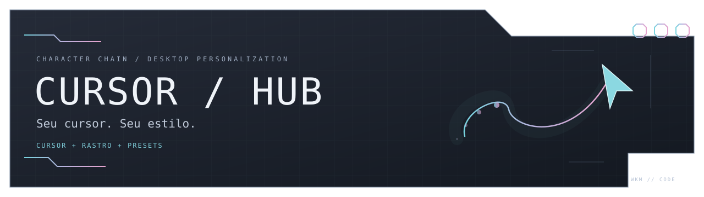
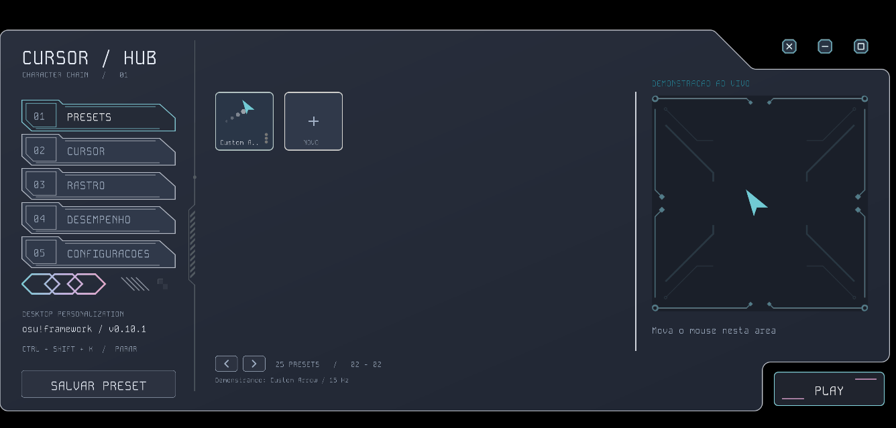

<div align="center">



**Personalize o cursor e o rastro do seu mouse. Dê movimento ao seu desktop.**

[](https://github.com/WKMcode-dev/Cursor_HUB/releases/latest)
[](https://github.com/WKMcode-dev/Cursor_HUB/releases/latest)
[](https://dotnet.microsoft.com/)
[](https://github.com/WKMcode-dev/Cursor_HUB/actions/workflows/release.yml)

### [↓ Baixar Cursor Hub v0.10.1 para Windows](https://github.com/WKMcode-dev/Cursor_HUB/releases/download/v0.10.1/CursorHub-0.10.1-win-x64.exe)

Um executável. Sem instalar .NET ou Visual Studio.

[Funcionalidades](#o-que-você-pode-personalizar) · [Como usar](#comece-em-poucos-passos) · [Desempenho](#ajuste-ao-seu-computador) · [Código-fonte](#para-quem-desenvolve)

</div>

---

## Um toque de osu! no seu desktop

O **Cursor Hub** nasceu dos cursores e rastros do osu! e evoluiu para um aplicativo de personalização do mouse para Windows. Troque a imagem do ponteiro, desenhe seu rastro e organize combinações em presets — com uma demonstração ao vivo antes de ativar os efeitos no computador.

Construído com **C#, .NET 10 e osu!framework**, com interface de recortes geométricos, detalhes em ciano e fonte Kode Mono.

<picture>
  <source media="(prefers-color-scheme: dark)" srcset="docs/images/cursorhub-dark.png">
  <source media="(prefers-color-scheme: light)" srcset="docs/images/cursorhub-light.png">
  
</picture>

<p align="center"><sub>Captura real da v0.10.1. Temas claro e escuro disponíveis no aplicativo.</sub></p>

## O que você pode personalizar

| Recurso | Do seu jeito |
| :--- | :--- |
| **Ponteiro** | Formato circular ou imagem PNG/SVG, com tamanho independente do rastro. |
| **Rastro** | Imagem ou partículas circulares, tamanho, duração e cor próprios. |
| **Cores** | Paleta pronta e seletor RGB para os formatos circulares. Imagens preservam suas cores. |
| **Imagem e hotspot** | Gire, inverta e posicione a mira que define o ponto de clique do cursor. |
| **Presets** | Crie, edite, use e exclua combinações pelo menu de três pontos. |
| **Demonstração** | Experimente a combinação na área à direita antes de usar PLAY. |
| **Interface** | Temas claro/escuro e opção de desativar animações. |
| **Desempenho** | Limite de desenho, economia, captura detalhada e orçamento de partículas. |

## Comece em poucos passos

1. **[Baixe o executável da release oficial](https://github.com/WKMcode-dev/Cursor_HUB/releases/latest)** e abra o arquivo `.exe`. Feche qualquer versão anterior que esteja aberta.
2. Clique em **+ NOVO** para criar um preset. Personalize as abas **CURSOR**, **RASTRO** e **AJUSTES**, dê um nome e clique em **SALVAR PRESET**.
3. Mova o mouse na demonstração para conferir o resultado. O menu **⋮** de cada card permite **usar, editar ou excluir** o preset.
4. Clique em **PLAY** para ativar os efeitos no computador. Use **STOP** ou **Ctrl + Shift + X** para interrompê-los.

O botão lateral **SALVAR PRESET** também salva o preset aberto no editor. Sem um preset selecionado, ele abre a criação de um novo. Ao editar um preset selecionado nas abas principais, volte à galeria para ver sua miniatura atualizada e salve para manter as alterações.

> Mudou os ajustes enquanto o efeito estava ativo? Use **STOP → PLAY** para aplicar a nova combinação ao desktop.

## Ajuste ao seu computador

O limite de desenho é configurável de **30 a 360 Hz**. Comece com um valor próximo à frequência do monitor e ajuste conforme o desempenho do sistema: 60, 75, 144 e 165 Hz têm atalhos na interface.

- **Economia:** reduz a atualização da demonstração parada para 15 Hz.
- **Partículas:** escolha entre 256, 512 ou 1024 pontos.
- **Captura detalhada:** usa o histórico de movimento do Windows para recuperar mais pontos da trajetória.

O rastro usa buffers limitados e uma camada nativa com transparência por pixel. O consumo e a fluidez dependem do hardware, dos ajustes e dos aplicativos em execução.

**Compatibilidade:** aplicativos com cursor próprio, jogos em tela cheia exclusiva e áreas seguras do Windows podem limitar a exibição dos efeitos. O aplicativo não garante sobreposição em todos os jogos.

## Seu executável e seus presets

Pode mover **somente o `.exe`** para outra pasta ou para a área de trabalho. O runtime e as bibliotecas acompanham o aplicativo; arquivos de apoio são preparados automaticamente no perfil do usuário.

Presets, configurações e imagens importadas ficam em:

```text
%LOCALAPPDATA%\CursorHub
```

Mover o executável não apaga esses dados. Para levar sua coleção a outro computador, copie também essa pasta, incluindo as imagens importadas. Cada release disponibiliza `SHA256SUMS.txt` para verificar o arquivo baixado.

## Verificado antes de publicar

A **v0.10.1** passou pela [validação automatizada no Windows](https://github.com/WKMcode-dev/Cursor_HUB/actions/runs/39869850187), executando o aplicativo empacotado em uma pasta contendo apenas o `.exe`.

Os testes cobrem cliques e digitação, criação/edição/exclusão de presets, seletores RGB reais, importação de SVG pelo gerenciador, imagens e hotspot, cores das miniaturas, paginação, temas, escala, minimizar/maximizar, Play/Stop e rastro sobre janelas independentes. Também verificam falha de gravação com nova tentativa e restauração dos dados ao reabrir o aplicativo em outro processo.

A matriz de lógica inclui **199 cenários de estados e trajetórias**. Capturas e relatórios ficam nos artifacts do workflow. Essa cobertura ajuda a detectar regressões; a compatibilidade com cada hardware e jogo ainda depende do ambiente.

## Para quem desenvolve

Requisitos: **Windows x64**, **SDK .NET 10** e Git.

```powershell
git clone https://github.com/WKMcode-dev/Cursor_HUB.git
cd Cursor_HUB
dotnet run --project CursorHub/CursorHub.csproj
```

Para executar as verificações de lógica:

```powershell
dotnet run --project CursorHub/Checks/Checks.csproj -c Release
```

Veja o [guia técnico](CursorHub/README.md) para estrutura, recursos e publicação do executável único.

## Encontrou algo estranho?

[Abra uma issue](https://github.com/WKMcode-dev/Cursor_HUB/issues) com a versão do Cursor Hub, versão do Windows, passos para reproduzir e, se possível, uma captura ou gravação. Isso ajuda a transformar o problema em um teste de regressão.

---

<div align="center">

**Criado por [WKMcode-dev](https://github.com/WKMcode-dev)** · Inspirado na experiência de cursores do osu!

<sub>Projeto independente, sem afiliação oficial ao osu!.</sub>

</div>
